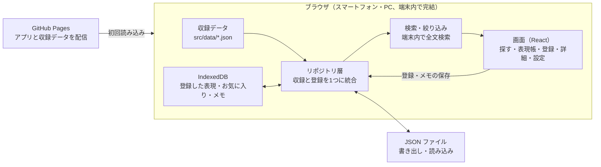

# 紳士の表現帳 — 設計ドキュメント

最終更新：2026-10-21

## 概要

「紳士の表現帳」は、気品ある言葉遣いを場面ごとに引ける辞典アプリです。気に入った表現は自分のコレクションとして登録できます。スマートフォンのブラウザで開くだけで使え、インストールも会員登録も不要です。

- **目的**：挨拶から感謝、お詫び、お断りまで、場面に合った洗練された言い回しをすぐ見つけられるようにする
- **対象ユーザー**：言葉遣いを磨きたい人、ビジネスや改まった場で使える表現を探す人、言葉そのものを楽しみたい人
- **提供する価値**：
  - 場面と格式の高さから表現を引ける
  - 表現ごとに意味・使いどころ・例文が分かる
  - 気になった表現を登録し、自分だけの表現帳を育てられる

収録するのは日本語・英語・フランス語・ドイツ語・イタリア語・スペイン語の 6 言語で、初版から同じ仕組みで扱います。英語は現代の丁寧な言い回しから、"I am much obliged." のような古風な表現まで幅広く収録します。

## 言語・技術選定

**TypeScript + React（Vite）で作る静的 Web アプリ（PWA）**を採用します。決め手は「誰でも、どの端末でも、無料で、すぐに使えること」です。

### 選んだ理由

1. **どの端末でも動く**：iPhone、Android、PC のブラウザで同じアプリが動きます。PWA にすればホーム画面に追加でき、オフラインでも開けます。
2. **サーバーが要らない**：収録データはアプリに同梱し、登録した表現は端末内に保存します。そのため GitHub Pages で無料公開でき、運用費は 0 円です。
3. **型でデータを守れる**：このアプリの中心は「表現」というデータです。TypeScript なら、収録データに必須項目の漏れやカテゴリ名の誤字があれば、ビルドの時点で検出できます。
4. **将来の拡張に強い**：同期機能を足すときも、同じ TypeScript でバックエンド（Cloudflare Workers、Supabase など）を書けます。
5. **情報と人材が多い**：React と TypeScript は利用者が多く、困ったときに情報が見つかりやすい構成です。

### 比較した候補

| 候補                           | 良い点                            | 見送った理由                                       |
| ------------------------------ | --------------------------------- | -------------------------------------------------- |
| **TypeScript + React（採用）** | 全端末対応、サーバー不要、型安全  | —                                                  |
| Python（Flask / Django）       | 書きやすく、データ処理に強い      | 常時動くサーバーが必要で、運用費と手間がかかる     |
| Swift（iOS アプリ）            | 操作感が最も滑らか                | iPhone だけになる。App Store の審査と年会費が必要  |
| Flutter（Dart）                | 1 つのコードで iOS / Android 両方 | ストア配布が前提。この規模には重い                 |
| 素の HTML + JavaScript         | 最も軽い                          | 検索・絞り込み・登録画面が増えると管理しづらくなる |

ストアアプリが必要になったときも、Capacitor で今のコードを包めば作り直しは不要です。

## 設計思想

このアプリは「紳士の作法」をそのまま設計原則にしています。控えめで、相手の時間を奈わず、預かったものは大切にする、という考え方です。

1. **控えめであること（シンプルさ）**：機能は「引く・選ぶ・残す」に絞ります。画面も部品も必要な分だけにし、来ない未来のために作り込みません。
2. **相手を待たせないこと（速さとオフライン）**：収録データはすべてアプリに同梱し、検索は端末内で完結します。電波のない場所でも、入力した瞬間に結果が出ます。
3. **預かったものを守ること（プライバシー）**：登録した表現は利用者の端末にだけ保存し、外部に送りません。代わりに JSON で書き出し・読み込みできるようにし、データはいつでも利用者の手元にあります。
4. **言葉と絵を分けること（データと表示の分離）**：表現はコードと切り離したデータファイルで管理します。表現を足すときにプログラムを触る必要はありません。
5. **収録と自分の登録を対等に扱うこと**：収録表現も利用者が登録した表現も同じ型です。同じ検索・同じカードで並び、「自分の表現帳」として一体に育ちます。
6. **品のある体裁**：明朝体の見出し、落ち着いた配色、十分な余白。中身にふさわしい佳まいにし、ダークモードにも対応します。

## 機能要件

初版（v1）で実装するのは、下表の「必須」の 7 機能です。「推奨」は余力があれば v1 に含めます。

| 機能               | 内容                                                                                     | 優先度 |
| ------------------ | ---------------------------------------------------------------------------------------- | ------ |
| 表現の閲覧         | 場面別に表現をカードで一覧表示。カードを開くと意味・使いどころ・例文が読める             | 必須   |
| 全文検索           | 表現・読み・意味・例文・言い換え語を対象に、入力と同時に絞り込む                         | 必須   |
| 絞り込み           | 場面・格式の高さ・言語（日・英・仏・独・伊・西）・古風かどうか・「自分の登録のみ」で絞る | 必須   |
| お気に入り         | 収録表現に印を付け、一覧で見返せる                                                       | 必須   |
| 表現の登録         | 気になった表現をフォームから登録。必須は「表現」と「場面」の 2 項目だけ                  | 必須   |
| 編集・削除         | 自分で登録した表現を直す・消す。収録表現は編集不可（写して登録は可）                     | 必須   |
| メモ               | 収録表現にも自分用のメモ（使った場面など）を残せる                                       | 必須   |
| 書き出し・読み込み | 登録内容を JSON で保存・復元。機種変更やバックアップに使う                               | 推奨   |
| コピー             | ワンタップで表現をクリップボードへ                                                       | 推奨   |
| 今日の一言         | 開くたびに表現を 1 つ紹介                                                                | 推奨   |

### 非機能要件

- 収録 1,000 件でも検索結果が 100 ミリ秒以内に出る
- 初回表示後はオフラインで全機能が使える
- スマートフォンの片手操作を前提にした配置
- キーボード操作とスクリーンリーダーに対応（WCAG 2.2 AA 相当）

## 表現の分類体系

表現は「場面」と「格式の高さ」の 2 軸で分類します。場面は「何を伝えたいか」、格式は「どれだけ改まった場か」を表します。

### 場面（12 分類）

| 場面         | 収録例                                              |
| ------------ | --------------------------------------------------- |
| 挨拶         | ご機嫌麗しゅう / お目にかかれ光栄です               |
| 感謝         | 痛み入ります / 身に余るお言葉です                   |
| お詫び       | 心よりお詫び申し上げます / 不徳の致すところです     |
| 称賛         | さすがのご慵眼です / 感服いたしました               |
| 依頼         | 恐縮ですが / ご高配を賜りますよう                   |
| お断り       | せっかくのお申し出ですが / 今回は見送らせてください |
| 労い・気遣い | ご自愛ください / お心遣い痛み入ります               |
| お祝い       | 心よりお喜び申し上げます                            |
| お悔やみ     | 謹んでお悔やみ申し上げます                          |
| 謙遜         | 恌れ入ります / 非才の身ではありますが               |
| 別れ         | 名残惜しいですが / どうぞご息災で                   |
| 気品ある語彙 | 御辞儀 / 幸甘 / 知惠を拝借する                      |

「気品ある語彙」は場面に縛られない、貴族的・高雅な単語の置き場です。収録例は仕様を示すための例で、本番の収録内容は実装時に精査します。

### 英語の収録例

英語も同じ 12 場面・3 段階で分類します。古風な表現には `archaic` を立て、絞り込みで出し分けられるようにします。

| 場面         | 現代の丁寧な表現                 | 古風な表現                                           |
| ------------ | -------------------------------- | ---------------------------------------------------- |
| 挨拶         | It's a pleasure to meet you.     | How do you do? / Good day to you, sir.               |
| 感謝         | I truly appreciate it.           | I am much obliged. / Most kind of you.               |
| お詫び       | Please accept my apologies.      | I beg your pardon. / I humbly crave your indulgence. |
| 称賛         | That was splendidly done.        | My compliments, sir.                                 |
| 依頼         | Would you be so kind as to...?   | Might I trouble you to...? / Pray, do...             |
| お断り       | I'm afraid I must decline.       | I regret that I am unable to oblige.                 |
| 別れ         | It has been a pleasure.          | I bid you good day. / Farewell.                      |
| 気品ある語彙 | splendid / delightful / gracious | indeed / pray / henceforth                           |

### 格式の高さ（3 段階）

| 段階         | 使う場           | 例（感謝）                         |
| ------------ | ---------------- | ---------------------------------- |
| 品のよい日常 | 知人、職場の同僚 | 助かりました、ありがとうございます |
| 改まった場   | 取引先、目上の方 | 痛み入ります                       |
| 儀礼・文語   | 式典、手紙、礼状 | 厚く御礼申し上げます               |

タグは自由に複数付けられます（例：手紙向き、ビジネス、英国風）。場面と格式の高さは固定の選択肢にし、分類が曖昧になるのを防ぎます。

## データモデル

中心は `Expression`（表現）と `Annotation`（利用者の印とメモ）の 2 つです。収録表現と登録表現は同じ `Expression` 型で、`source` で区別します。

```typescript
type Scene =
  | 'greeting'
  | 'gratitude'
  | 'apology'
  | 'praise'
  | 'request'
  | 'decline'
  | 'care'
  | 'celebration'
  | 'condolence'
  | 'humility'
  | 'farewell'
  | 'vocabulary';

type Formality = 1 | 2 | 3; // 1: 品のよい日常 / 2: 改まった場 / 3: 儀礼・文語

interface Expression {
  id: string; // 収録: 'builtin-0001' / 登録: UUID
  source: 'builtin' | 'user';
  text: string; // 表現そのもの（必須）
  reading?: string; // 読み仮名
  lang: 'ja' | 'en' | 'fr' | 'de' | 'it' | 'es';
  scene: Scene; // 場面（必須）
  formality: Formality;
  archaic: boolean; // 古風な言い回し（英語の古語、文語調など）
  meaning?: string; // 意味
  usage?: string; // 使いどころ・注意点
  examples: string[]; // 例文
  tags: string[];
  keywords: string[]; // 検索用の言い換え語（例：ありがとう、thanks）
  citation?: Citation; // 出典。無ければ「出典未詳」と表示
  createdAt?: string; // 登録表現のみ（ISO 8601）
  updatedAt?: string;
}

interface Citation {
  title: string; // 例：デジタル大辞泉「痛み入る」
  publisher?: string; // 例：小学館
  url?: string; // http(s) のみ
}

interface Annotation {
  expressionId: string; // 収録・登録どちらの id も可
  favorite: boolean;
  note?: string; // 自分用メモ
  updatedAt: string;
}
```

### 収録データと登録データの扱い

|                  | 収録データ                                                          | 登録データ                 |
| ---------------- | ------------------------------------------------------------------- | -------------------------- |
| 置き場           | リポジトリの `src/data/expressions/*.json`（場面ごとに 1 ファイル） | 端末の IndexedDB           |
| 更新方法         | JSON を編集してプルリクエスト                                       | アプリの登録フォーム       |
| 利用者による編集 | 不可（メモとお気に入りは `Annotation` で付与）                      | 可                         |
| 検証             | ビルド時にスキーマで検査（Zod）                                     | 保存時に同じスキーマで検査 |

収録表現へのメモを `Expression` 本体ではなく `Annotation` に分けたのは、収録データを更新しても利用者のメモが消えないようにするためです。収録 id は一度付けたら変えません。

## アーキテクチャ

サーバーを持たず、すべてブラウザの中で動きます。データの読み書きは「リポジトリ層」1 か所に集め、画面は保存先を知らない作りにします。



画面は検索結果を表示し、登録やメモはリポジトリ層を通して IndexedDB に保存します。将来サーバー同期を足すときは、リポジトリ層の中身を差し替えるだけで済みます。

### ディレクトリ構成

```text
src/
  data/expressions/   収録表現（場面ごとの JSON）
  domain/             型定義と Zod スキーマ
  store/              リポジトリ層（収録 + IndexedDB の統合）
  search/             全文検索と絞り込み
  ui/
    pages/            5 つの画面
    components/       カード、検索欄、フォームなど
  styles/             配色・書体（ライト / ダーク）
tests/
  unit/               Vitest
  e2e/                Playwright
```

### 主な技術要素

- **保存**：IndexedDB を薄いラッパー（idb）経由で使う。localStorage より容量が大きく、構造化データを扱える
- **検索**：表記ゆれ（全角・半角、カタカナ・ひらがな、大文字・小文字）をそろえたうえで部分一致で探し、一致した項目の重みで並べる自前の仕組み。日本語は単語の区切りがないため、英語向けの検索ライブラリ（MiniSearch など）より確実に引ける。数千件までは十分速い
- **画面遷移**：React Router（ハッシュ形式）。GitHub Pages でも URL で表現を直接開ける

## 画面構成

画面は 5 つです。下部のタブバー（探す／表現帳／登録／設定）で行き来し、どの一覧からでも表現詳細を開けます。

| 画面           | URL                   | 主な内容                                                                             |
| -------------- | --------------------- | ------------------------------------------------------------------------------------ |
| 探す（ホーム） | `/`                   | 今日の一言、検索欄、場面チップ、格式フィルター、結果カード一覧                       |
| 表現詳細       | `/e/:id`              | 表現、読み、意味、使いどころ、例文、お気に入り、メモ、コピー。登録表現なら編集・削除 |
| 表現帳         | `/mine`               | お気に入りと自分の登録をまとめて表示。「お気に入り／登録した表現」で切替             |
| 登録・編集     | `/new`、`/e/:id/edit` | 入力フォーム。最初は「表現」「場面」だけ見せ、残りは「詳しく書く」で開く             |
| 設定           | `/settings`           | 書き出し・読み込み、表示テーマ、アプリ情報                                           |

登録フォームの入口を 2 項目に絞ったのは、「気になった瞬間に残せる」ことを優先するためです。意味や例文は後から足せます。

## 収録数の拡張と表示方針

収録表現は増やし続ける前提です。数千件までは今の設計のままで動き、件数が増えても「絞って見せる」表示で使いやすさを保ちます。

### 増やし方

| 方法               | 担う人                    | 手順                                                                     |
| ------------------ | ------------------------- | ------------------------------------------------------------------------ |
| 収録データへの追加 | 開発者（Claude に依頼可） | 場面ごとの JSON に追記してコミット。自動チェックを通れば公開版に自動反映 |
| アプリからの登録   | 利用者                    | 登録フォームから。端末の中に貯まる                                       |
| 表現集の取り込み   | 利用者                    | 他の人が作った表現集（JSON）を読み込む。v1.1 の書き出し・読み込みを流用  |

収録データは「お詫びの英語を古風なもの中心に 50 件」のような単位で追加します。追加のたびに、必須項目の漏れと重複を自動で検査します。

### 件数の目安

- **数千件まで**：全件をアプリに同梱したままでよい。端末内検索は 100 ミリ秒以内
- **1 万件超**：場面ごとに分けて、必要になったときに読み込む。変更はリポジトリ層の読み込み部分だけ

### 表示候補の出し方

1. **絞り込みが入口**：最初に場面チップを選ぶと、候補が数十件に収まる
2. **意味でも引ける検索**：表現ごとに検索用の言い換え語（`keywords`）を持たせる。「ありがとう」で「痛み入ります」や "I am much obliged." も出る
3. **並び順を選べる**：格式の低い順、お気に入りを上に、新しく追加された順
4. **少しずつ読み込む一覧**：スクロールに合わせて描画し、件数が増えても重くしない
5. **偶然の出会い**：「今日の一言」でランダムに 1 件紹介

### 出典の扱い

件数が増えるほど、正確さの担保が重要になります。表現ごとに出典（`citation`：書名・発行元・URL）を持たせ、下の優先順で選びます。実際に開いて内容を確かめたページだけを出典にし、確かめられないものは「出典未詳」と表示します。一覧のカードには「出典あり」の印を付けます。

1. **公的機関**：文化庁（「敬語の指針」など）、国立国語研究所
2. **辞書出版社の辞書**：日本語はデジタル大辞泉（小学館）など、英語は Cambridge Dictionary、Oxford Learner's Dictionaries、Merriam-Webster
3. **出典未詳**：上記で確かめられないもの。個人ブログやまとめサイトは出典にしない

## 品質・開発運用

プルリクエストごとに自動で検査し、`main` に入ったら GitHub Pages へ自動公開します。

| 項目           | 使うもの             | 役割                                            |
| -------------- | -------------------- | ----------------------------------------------- |
| 型チェック     | TypeScript（strict） | 型の食い違いを検出                              |
| リント・整形   | ESLint + Prettier    | 書き方を揃え、よくある誤りを検出                |
| 単体テスト     | Vitest               | 検索・絞り込み・保存処理を検証                  |
| 収録データ検証 | Zod スキーマ         | 必須項目の漏れ、id の重複、未定義の場面を検出   |
| E2E テスト     | Playwright           | 「検索→詳細→登録→表現帳」を実際のブラウザで確認 |
| CI             | GitHub Actions       | 上記をプルリクエストごとに実行                  |
| 公開           | GitHub Pages         | `main` への反映で自動公開                       |

### クラウド環境の初期設定

リポジトリの `.claude/settings.json` に SessionStart フックを置き、セッション開始時に `npm ci` を自動実行します。これでどのセッションでも、変更をプッシュする前にテストとリントを回せます。あわせて `CLAUDE.md` に構成・コマンド・収録データの書き方をまとめます。

## 今後の拡張とロードマップ

まず v1 を公開し、使ってみてから次を決めます。各段階は前の段階が完了してから着手します。

1. **v1：土台**
   - 閲覧・検索・絞り込み・お気に入り・登録・メモ
   - 収録表現を 6 言語それぞれ各場面 2 件、計 144 件から始め、出典を確認しながら各場面 10 件前後まで増やす（古風な表現も含む）
   - CI と GitHub Pages への自動公開
2. **v1.1：使い勝手**
   - 書き出し・読み込み、コピー、今日の一言
   - PWA 化（ホーム画面への追加、オフライン）
3. **v2：広がり**
   - 音声読み上げ（ブラウザ標準の Web Speech API）
   - 日英で意味の近い表現の対応付け（例：痛み入ります ⇔ I am much obliged.）
   - 「この表現をより丁寧に」など、格式の高さを上下した言い換えの提示
4. **v3：同期（必要になった場合のみ）**
   - ログインして複数端末で表現帳を共有
   - この段階で初めてサーバーを追加する。保存部分を 1 か所にまとめてあるので、差し替え範囲は小さく済む

### 未決事項

- [x] 英語は v1 から収録する（古風な表現も含む）
- [ ] 収録表現の出典・監修をどう担保するか
- [ ] アプリ名を「紳士の表現帳」で確定するか
